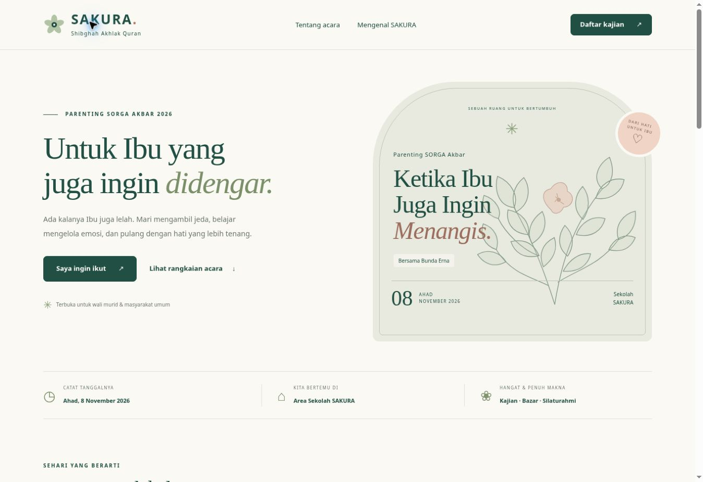
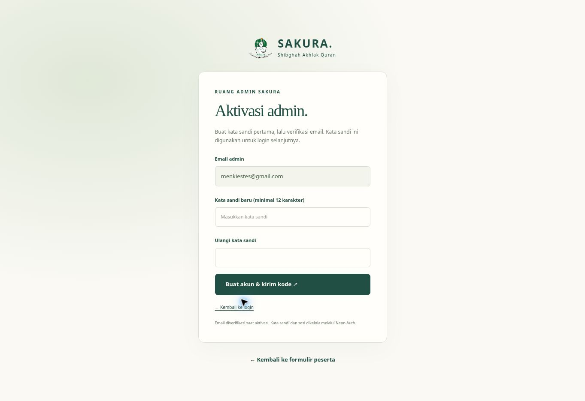
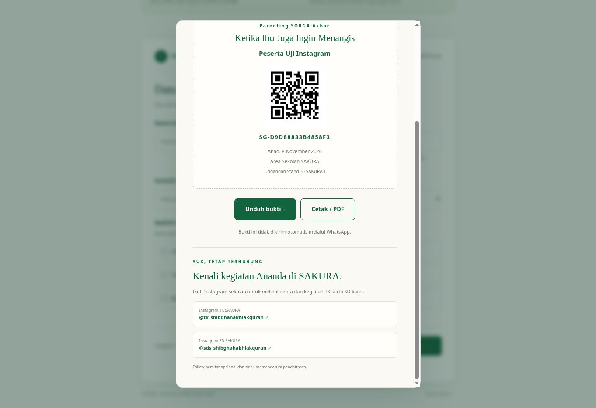

# SAKURA — Form Parenting SORGA Akbar

Form peserta **“Ketika Ibu Juga Ingin Menangis”**, Ahad **8 November 2026**, untuk Sekolah Shibghah Akhlak Quran (TK / SD). Halaman langsung membuka formulir dengan logo resmi sekolah.

**Cloudflare Pages + Pages Functions + Neon Postgres + Neon Auth.** Semua peserta tersimpan di Neon melalui API server; database tidak diakses langsung dari browser.



## Fitur

- Form tiga langkah: data peserta → mengenal SAKURA → referral dan persetujuan.
- Sepuluh kode tetap: **SAKURA1, SAKURA2, …, SAKURA10**. Nama bawaan **Stand 1** sampai **Stand 10**.
- Tautan `/?ref=SAKURA3` mengisi referral otomatis. Tautan versi awal seperti `SAKURA03` tetap diterima dan disimpan sebagai `SAKURA3`.
- Pertanyaan pernah mengenal sekolah, sumber informasi sekolah, kelompok usia anak, hubungan dengan SAKURA, dan minat TK / SD. Sumber informasi sekolah dan referral stand dicatat terpisah.
- Bukti pendaftaran QR, unduh SVG, cetak / simpan PDF. Satu WhatsApp untuk satu peserta.
- Setelah berhasil mendaftar, muncul ajakan follow Instagram **opsional**: [TK SAKURA](https://www.instagram.com/tk_shibghahakhlakquran/) dan [SD SAKURA](https://www.instagram.com/sds_shibghahakhlakquran/). Tidak ada syarat follow atau pemeriksaan akun Instagram.
- `/admin/`: aktivasi email dan kata sandi pertama, verifikasi kode email, login, lupa kata sandi, daftar peserta, statistik, check-in, souvenir, serta unduh spreadsheet CSV.
- Admin dapat mengganti **nama stand, nama pemilik / penanggung jawab, kelas, dan status aktif**. Kode tetap sehingga riwayat peserta tidak terputus.
- CSV mengikuti filter aktif, bisa dibuka di **Excel** atau diimpor ke **Google Sheets**. Database tidak dipublikasikan sebagai spreadsheet umum dan tidak melakukan sinkronisasi Google Sheets otomatis.




## Neon yang disiapkan

| Bagian | Nilai |
| --- | --- |
| Project | `form-bazar-sakura` |
| Project ID | `square-star-75464154` |
| Production branch | `br-super-waterfall-azy86wlg` |
| Database | `sakura` |
| Region | AWS Singapore |
| Admin aplikasi | `menkiestes@gmail.com` |

Neon Auth sudah diaktifkan. Konfigurasi layanan publik ada di `server/deployment-config.mjs`; tidak ada password admin atau connection string di Git.

Schema aplikasi ada di [`migrations/0001_neon.sql`](migrations/0001_neon.sql). Migrasi menyiapkan sepuluh stand tanpa menimpa perubahan nama atau menghapus peserta. Berkas D1 lama disimpan di `migrations/legacy-d1/` untuk referensi, bukan dijalankan pada Neon.

## Deploy Cloudflare Pages

Hubungkan repository ini sebagai **Pages** melalui Git integration.

| Pengaturan | Nilai |
| --- | --- |
| Production branch | `main` |
| Framework preset | `None` |
| Build command | `npm run build` |
| Build output directory | `dist` |
| Root directory | Root repo / kosong |
| `NODE_VERSION` | `24` |

Paket dipasang otomatis dari `package-lock.json`. Jika dibangun di komputer sendiri, jalankan `npm ci` lebih dulu. Direktori `functions/` dibaca oleh Pages dari root repo.

### Secret database

Di Neon Console, buka project di atas → **Connect** → pilih database `sakura`, branch **production**, dan koneksi **Pooled**. Salin connection string.

Di Cloudflare Pages → **Settings → Variables and Secrets → Production**, tambahkan:

| Nama | Jenis | Keterangan |
| --- | --- | --- |
| `DATABASE_URL` | **Secret, wajib** | Connection string Neon pooled. Jangan gunakan URL branch pengujian. |
| `SESSION_SECRET` | Secret, disarankan | Nilai acak minimal 32 karakter untuk hash pembatasan percobaan. Jika tidak diisi, salt diturunkan dari konfigurasi server yang bersifat rahasia. |
| `EVENT_VENUE` | Variable, opsional | Lokasi acara yang sudah dikonfirmasi. Bawaan: Area Sekolah SAKURA. |
| `REGISTRATION_OPEN` | Variable, opsional | `true` membuka, `false` menutup pendaftaran. |
| `NEON_AUTH_BASE_URL` | Variable, opsional | Bawaan sudah mengarah ke layanan Auth production yang disiapkan. Ubah hanya jika berpindah project / branch. |

**Redeploy setelah mengisi secrets.** Binding D1 dan `ADMIN_PASSWORD` versi awal tidak dipakai lagi. Password admin baru dibuat sendiri melalui aktivasi; tidak dimasukkan ke Cloudflare atau GitHub.

Untuk deployment Preview, gunakan database dan Auth branch terpisah. Jangan menghubungkan preview yang dapat diubah orang lain ke data produksi. Jika belum menyiapkan backend preview, jangan mengisi `DATABASE_URL` produksi pada environment Preview.

### Schema database

Jika schema pada project baru belum ada, jalankan isi `migrations/0001_neon.sql` di Neon SQL Editor, atau gunakan koneksi langsung melalui CLI lokal:

```bash
# Isi DATABASE_URL_UNPOOLED di environment sendiri, lalu:
npm run db:migrate
```

Koneksi langsung untuk migrasi berbeda dengan pooled untuk aplikasi. Script tidak mencetak connection string dan tidak menghapus data.

### Pemeriksaan setelah deploy

1. Buka `/api/config`: `ready` dan `registrationOpen` harus `true`, sepuluh kode harus muncul berurutan.
2. Buka `/admin/` dan lakukan aktivasi di bawah.
3. Di **Stand & referral → Edit**, isi nama stand dan pemilik aslinya.
4. Bagikan tautan / QR dari domain akhir yang dipakai, misalnya `/?ref=SAKURA1`.
5. Pastikan lokasi dan jadwal sesuai sebelum formulir disebarkan.

## Aktivasi dan login admin

1. Buka `/admin/`, pilih **Pertama kali? Aktivasi admin**.
2. Email tetap **menkiestes@gmail.com**. Buat kata sandi minimal **12 karakter**, lalu ulangi untuk memastikan tidak salah ketik.
3. Klik **Buat akun & kirim kode**. Periksa inbox / spam email tersebut.
4. Masukkan kode verifikasi email.
5. Setelah email terverifikasi, masuk dengan email dan kata sandi yang tadi dibuat. Kata sandi itu digunakan untuk login selanjutnya.
6. Jika lupa, pilih **Lupa kata sandi**; pemulihan membutuhkan kode yang diterima di email admin.

Tidak ada password bawaan produksi, signup untuk email lain, atau akses data hanya karena mengetahui alamat email admin. Akun yang emailnya belum terverifikasi tidak mendapat akses API admin.

**Pengiriman email:** Neon mengelola kode verifikasi dan pemulihan. Layanan yang baru disiapkan memakai shared SMTP untuk pengembangan. Sebelum peluncuran produksi, konfigurasi **custom SMTP** di Neon Auth sesuai [production checklist resmi](https://neon.com/docs/auth/production-checklist). Pengiriman kode ke email asli memerlukan pengujian oleh pemilik email saat aktivasi; proses itu tidak dilakukan oleh tes otomatis.

Login menggunakan SDK Neon Auth dan proxy pada origin aplikasi sehingga cookie sesi tetap first-party. API admin memverifikasi tanda tangan Ed25519, issuer, audience, umur token, email yang diizinkan, status verifikasi, dan status banned. Token API berlaku maksimal 15 menit dan diperbarui melalui sesi Neon. Logout mengakhiri sesi browser; token yang sebelumnya sudah diterbitkan dapat berlaku sampai kedaluwarsa.

## Mengelola peserta dan spreadsheet

- **Daftar peserta:** cari nama, WhatsApp, atau kode tiket; filter stand, kehadiran, atau persetujuan PPDB.
- **Tandai hadir:** mencatat kedatangan. QR bukti berisi kode tiket; kode dari pemindai dapat dimasukkan ke pencarian.
- **Souvenir:** hanya dapat diserahkan untuk peserta yang sudah hadir. Pembatalan kehadiran juga membatalkan status souvenir.
- **Stand & referral:** nama, pemilik, dan kelas dapat diganti tanpa mengubah kode. Stand nonaktif tidak menerima pendaftaran baru, tetapi riwayatnya tetap ada.
- **Unduh spreadsheet:** menghasilkan CSV UTF-8 sesuai filter aktif. Di Excel buka file tersebut; di Google Sheets gunakan **File → Import → Upload**. Nomor WhatsApp dijaga sebagai teks dan input yang berpotensi dianggap formula di-escape.
- Untuk tindak lanjut PPDB, pilih filter **Bersedia dihubungi PPDB**. Persetujuan promosi terpisah dari persetujuan pendataan acara.

Rekap apresiasi memakai tamu masyarakat umum yang hadir. Target 3 + 1 berarti sedikitnya tiga tamu umum hadir, termasuk satu dengan anak usia prasekolah / TK / SD. Keputusan apresiasi tetap oleh panitia.

## Pengembangan lokal

```bash
npm ci
npm run dev
```

Buka `http://localhost:4173/`. Pengembangan formulir memakai Postgres lokal melalui PGlite di `.local/postgres/`, terpisah dari Neon production. Tidak ada password admin lokal bawaan. Alur login memakai layanan Neon Auth yang dikonfigurasi; gunakan Auth branch pengembangan jika ingin menguji akun sendiri. Jangan membuat akun admin produksi hanya untuk tes otomatis.

```bash
npm run build
npm run check
npm test
```

Tes menggunakan Postgres lokal dan token bertanda tangan dengan kunci khusus tes. Tes memeriksa validasi, normalisasi kode lama, database constraints, keunikan WhatsApp, penolakan akses tanpa verifikasi, email admin lain, issuer / audience salah, token kedaluwarsa, origin, whitelist proxy, rate limit, pengelolaan stand, check-in, souvenir, analitik, serta ekspor CSV lebih dari 500 baris.

`npm run build` membundel SDK auth untuk browser; bundle dihasilkan otomatis dan tidak ditulis sebagai source manual. Worker Functions dibundel Cloudflare saat deploy.

## Privasi dan penyimpanan

Data peserta tidak tersedia lewat API publik. Nama anak, alamat lengkap, dan data kesehatan tidak diminta. Persetujuan pendataan acara wajib; informasi TK / SD / PPDB melalui WhatsApp opsional. Tidak ada pengiriman WhatsApp otomatis.

Query memakai parameter. Password dan kode OTP dikelola Neon Auth, bukan disimpan sebagai teks biasa di tabel aplikasi. Password, OTP, token, dan connection string tidak dicatat ke log. Pembatasan percobaan memakai hash bucket IP yang kedaluwarsa.

Koreksi identitas, penarikan persetujuan, dan permintaan penghapusan ditangani pengelola di Neon setelah mencocokkan kode tiket. Dashboard mengubah stand, kehadiran, dan souvenir; belum mengedit / menghapus identitas peserta. Tinjau kebutuhan penyimpanan data setelah acara dan tutup pendaftaran dengan `REGISTRATION_OPEN=false` bila selesai.

Data yang pernah tersimpan di D1 tidak dipindahkan otomatis oleh perubahan kode. Jika versi awal sudah dipakai untuk pendaftar sungguhan, ekspor dan migrasikan data tersebut sebelum memindahkan domain / membuka versi Neon.

## Struktur

```text
public/               Form pengunjung, dashboard, logo, CSS dan JavaScript
src/admin-auth.js     Integrasi SDK Neon Auth untuk antarmuka admin
functions/api/        Route /api/* di Cloudflare Pages
server/               Validasi, query Neon, proxy dan otorisasi admin
migrations/           Schema Postgres; arsip schema D1 sebelumnya
scripts/              Build, migrasi dan preview lokal
tests/               Tes API dan otorisasi dengan Postgres lokal
```

Dokumentasi resmi: [Neon serverless driver](https://neon.com/docs/serverless/serverless-driver), [Neon email OTP](https://neon.com/docs/auth/guides/plugins/email-otp), [Neon JWT](https://neon.com/docs/auth/guides/plugins/jwt), dan [Cloudflare Pages](https://developers.cloudflare.com/pages/get-started/git-integration/).
